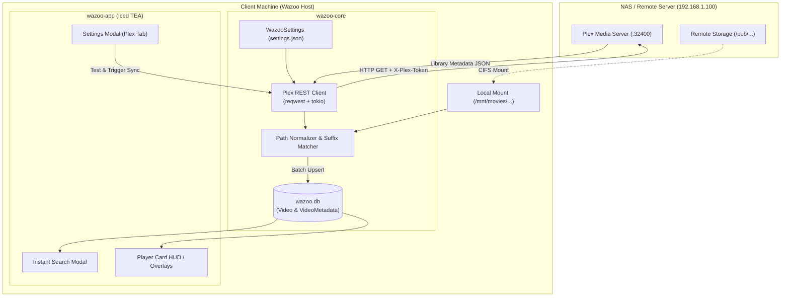
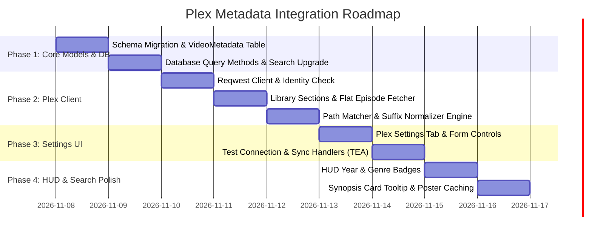

# Plex Media Server Metadata Integration Plan

This document outlines the architectural design, data models, network protocol, path-resolution algorithms, and user interface additions for integrating **Plex Media Server (PMS)** metadata into the **Wazoo** ambient media engine.

---

## 1. Vision & Objectives

Wazoo is an ambient multi-player and moving mood-board designed for artists, editors, and curators. While Wazoo currently relies on filename heuristic parsing (`format.rs`) to display titles, integrating Plex metadata elevates Wazoo into a semantic curation engine.

### Core Objectives
1. **Automated Rich Metadata Ingestion**: Fetch verified titles, series titles, seasons, episode numbers, release years, content ratings, plot synopses, genres, directors, and cast directly from Plex.
2. **Zero-Configuration Path Mapping**: Automatically correlate Plex's server-side filepaths (e.g., `/pub/movies/...` or `/volume1/...`) with Wazoo's local client mount paths (e.g., `/mnt/movies/...`) using suffix and subpath normalization.
3. **Multi-Dimensional Semantic Search**: Empower Wazoo's instant search modal to query not only raw filenames, but also release decades (`1980s`), specific years (`1999`), genres (`cyberpunk`, `sci-fi`, `horror`), directors (`tarantino`, `nolan`, `ghibli`), and plot keywords.
4. **Contextual HUD & Ambient Badges**: Present subtle, elegant release year chips, content ratings, genre tags, and plot synopsis tooltips within the player card overlays and Quick Picker.
5. **Non-Blocking Network Architecture**: Keep all network operations, sync passes, and image fetching entirely asynchronous via Tokio and background channels, ensuring 60+ FPS UI smoothness.

---

## 2. System Topology & Data Flow



---

## 3. Communication Protocol (Plex REST API)

Plex exposes a comprehensive REST API over HTTP/HTTPS on port `32400`. All requests from Wazoo pass standard Plex headers:

```http
X-Plex-Token: <USER_TOKEN>
X-Plex-Client-Identifier: wazoo-desktop-client
Accept: application/json
```

### Key Endpoints Used

| Endpoint | Purpose | Payload & Parsing |
| :--- | :--- | :--- |
| `GET /identity` | Connectivity & Version Verification | Returns `machineIdentifier`, `version`, and `claimed` status without requiring elevated scopes. |
| `GET /library/sections` | Discover Media Libraries | Returns list of library sections. Filtered for `type == "movie"` and `type == "show"`. Extracts library keys and server folder locations. |
| `GET /library/sections/{key}/all?includeGuids=1` | Bulk Fetch Movie Metadata | Returns all movies in a single JSON payload: `title`, `year`, `tagline`, `summary`, `contentRating`, `duration`, `rating`, `Genre`, `Director`, `Role`, `thumb`, `art`, and `Media.Part.file`. |
| `GET /library/sections/{key}/all?type=4` | Bulk Fetch TV Episodes | Setting `type=4` returns all episodes across all series in a single flat call: `grandparentTitle` (Show Name), `parentIndex` (Season), `index` (Episode), `title` (Episode Name), `year`, `summary`, `thumb`, and `Media.Part.file`. |
| `GET /library/metadata/{key}/thumb/{ts}` | High-Resolution Posters | On-demand poster thumbnail streaming, cached locally in `~/.cache/wazoo/posters/`. |

---

## 4. Path Resolution & Suffix Matching Algorithm

### The Discrepancy Problem
* **On NAS / Docker**: Files are indexed at `/pub/movies/Alien (1979)/Alien.mkv` or `/volume1/video/movies/...`.
* **In Wazoo Client**: Files are scanned locally at `/mnt/movies/movies/Alien (1979)/Alien.mkv`.
* Exact string matching fails because the root mount points differ.

### Multi-Tier Resolution Strategy
1. **Slash Normalization**: Convert all separators (`\` and `/`) to standard `/` and strip trailing slashes.
2. **Direct Exact Match**: Test if `plex_path == wazoo_path`.
3. **Library-Relative Match**:
   * Plex reports library root locations (e.g. `/pub/movies`).
   * Compute relative path inside Plex library: `Alien (1979)/Alien.mkv`.
   * Test if any configured Wazoo media folder contains `/Alien (1979)/Alien.mkv`.
4. **Hierarchical Suffix Match**:
   * Extract trailing path segments from the Plex path:
     - 1-segment: `Alien.mkv`
     - 2-segments: `Alien (1979)/Alien.mkv`
     - 3-segments: `movies/Alien (1979)/Alien.mkv`
   * Match against local indexed records in `Video(path)`.
   * Disambiguate multi-episode collisions using the 2+ segment parent folder.

```rust
pub fn match_plex_path(
    plex_path: &str,
    local_index: &HashMap<String, i64>,
    media_folders: &[String],
) -> Option<i64> {
    let norm_plex = plex_path.replace('\\', "/");

    // Tier 1: Exact
    if let Some(&id) = local_index.get(&norm_plex) {
        return Some(id);
    }

    // Tier 2: Suffix components (filename + parent folder)
    let segments: Vec<&str> = norm_plex.split('/').filter(|s| !s.is_empty()).collect();
    if segments.len() >= 2 {
        let suffix_2 = format!("{}/{}", segments[segments.len() - 2], segments[segments.len() - 1]);
        let candidates: Vec<i64> = local_index
            .iter()
            .filter(|(path, _)| path.replace('\\', "/").ends_with(&suffix_2))
            .map(|(_, &id)| id)
            .collect();

        if candidates.len() == 1 {
            return Some(candidates[0]);
        }

        // Tier 3: 3-segment check if disambiguation needed
        if segments.len() >= 3 && candidates.len() > 1 {
            let suffix_3 = format!(
                "{}/{}/{}",
                segments[segments.len() - 3],
                segments[segments.len() - 2],
                segments[segments.len() - 1]
            );
            if let Some((_, &id)) = local_index.iter().find(|(path, _)| path.replace('\\', "/").ends_with(&suffix_3)) {
                return Some(id);
            }
        }
    }

    None
}
```

---

## 5. Database Schema Extensions (`wazoo-core/src/db.rs`)

### New Table: `VideoMetadata`
A dedicated table storing structured metadata associated 1-to-1 with `Video(id)`:

```sql
CREATE TABLE IF NOT EXISTS VideoMetadata (
    video_id INTEGER PRIMARY KEY,
    plex_rating_key TEXT,
    title TEXT NOT NULL,
    series_title TEXT,
    season_number INTEGER,
    episode_number INTEGER,
    year INTEGER,
    tagline TEXT,
    summary TEXT,
    content_rating TEXT,
    duration_ms INTEGER,
    rating REAL,
    studio TEXT,
    genres TEXT,       -- JSON array of strings e.g. ["Action", "Sci-Fi"]
    directors TEXT,    -- JSON array of strings e.g. ["Ridley Scott"]
    actors TEXT,       -- JSON array of strings e.g. ["Sigourney Weaver", "Tom Skerritt"]
    thumb_url TEXT,    -- Remote Plex thumbnail endpoint
    art_url TEXT,      -- Remote Plex backdrop endpoint
    updated_at INTEGER,
    FOREIGN KEY (video_id) REFERENCES Video(id) ON DELETE CASCADE
);

CREATE INDEX IF NOT EXISTS meta_year_idx ON VideoMetadata(year);
CREATE INDEX IF NOT EXISTS meta_title_idx ON VideoMetadata(title);
CREATE INDEX IF NOT EXISTS meta_series_idx ON VideoMetadata(series_title);
```

### Enhanced Multi-Field Search
Wazoo's query parser in `db.rs` is upgraded with a `LEFT JOIN VideoMetadata m ON Video.id = m.video_id`:
* Positive query terms match against:
  - `Video.path` (existing)
  - `Video.name` (existing)
  - `m.title`
  - `m.series_title`
  - `m.genres` (e.g. `sci-fi`, `horror`)
  - `CAST(m.year AS TEXT)` (e.g. `1982`, `1999`)
  - `m.directors` (e.g. `kubrick`, `tarantino`)
  - `m.actors` (e.g. `harrison ford`)
  - `m.summary`

---

## 6. Domain Models & Configuration (`wazoo-core/src/models.rs`)

### 1. `MediaMetadata` Struct
```rust
#[derive(Debug, Clone, PartialEq, Serialize, Deserialize, Default)]
pub struct MediaMetadata {
    pub video_id: i64,
    pub plex_rating_key: Option<String>,
    pub title: String,
    pub series_title: Option<String>,
    pub season_number: Option<u32>,
    pub episode_number: Option<u32>,
    pub year: Option<u32>,
    pub tagline: Option<String>,
    pub summary: Option<String>,
    pub content_rating: Option<String>,
    pub duration_ms: Option<u64>,
    pub rating: Option<f32>,
    pub studio: Option<String>,
    #[serde(default)]
    pub genres: Vec<String>,
    #[serde(default)]
    pub directors: Vec<String>,
    #[serde(default)]
    pub actors: Vec<String>,
    pub thumb_url: Option<String>,
    pub art_url: Option<String>,
    pub updated_at: Option<u64>,
}
```

### 2. `PlexSettings` Struct
```rust
#[derive(Debug, Clone, PartialEq, Serialize, Deserialize)]
#[serde(default)]
pub struct PlexSettings {
    pub enabled: bool,
    pub server_url: String,       // Default: "http://192.168.1.100:32400"
    pub token: String,            // User's X-Plex-Token
    pub auto_sync_on_scan: bool,  // Automatically sync when folder scan runs
    pub last_synced_at: Option<u64>,
}
```

---

## 7. User Interface Additions (`wazoo-app`)

### 1. Plex Tab in Settings Modal
A new navigation button in the settings modal tabs bar: `[⚙ General] [▶ Playback] [✨ Filters] [📺 CRT] [🧊 3D Cube] [🍿 Plex] [💻 System]`.

#### Controls within the Plex Tab:
* **Toggle Integration**: Enable/disable Plex metadata enrichment.
* **Server URL Input**: Text input initialized to `http://192.168.1.100:32400`.
* **Plex Token Input**: Masked password-style field with a quick paste button and a help link explaining how to retrieve the `X-Plex-Token`.
* **Test Connection Button**: Sends a fast async request to `/identity`. Displays a green badge with the server version & machine name, or a red error badge with actionable feedback.
* **Sync Now Button**: Triggers full library synchronization. Displays a progress bar, items processed counter, and elapsed time.
* **Auto-Sync Toggle**: "Sync Plex metadata automatically after folder scan".

### 2. Player Card HUD Enhancements
* **Rich Title Pill**:
  * Line 1: `Movie Title` or `Series Name`
  * Line 2: `S01E05 - Gray Matter (2008)`
  * Badge Row: Subtle pills showing `[1999] [PG-13] [Sci-Fi] [Action]`
* **Plot Synopsis Tooltip**:
  * Hovering or clicking an info badge reveals a frosted backdrop card displaying the movie tagline, synopsis, director, and lead cast.

### 3. Quick Picker & Search Drawer
* Search result rows display the year and primary genre chip next to the title.
* Search syntax hints include examples: `anime, 1990s`, `sci-fi, not horror`, `nolan`.

---

## 8. Implementation Milestones



| Phase | Milestone | Deliverables |
| :--- | :--- | :--- |
| **Phase 1** | **Data Models & Schema** | Add `MediaMetadata` & `PlexSettings` models. Create `VideoMetadata` table in `wazoo-core/src/db.rs`. Extend `search_videos` to query metadata fields. |
| **Phase 2** | **Plex Client & Sync Engine** | Implement `wazoo-core/src/plex.rs` with `reqwest`. Add `/identity`, `/library/sections`, and bulk `/all` ingestion. Implement the path suffix matcher. |
| **Phase 3** | **UI Settings & Sync Flow** | Add `SettingsTab::Plex` in `wazoo-app`. Implement `TestConnection` and `SyncPlex` async TEA messages and status widgets. |
| **Phase 4** | **Presentation & Search Integration** | Render metadata badges in `hud.rs` and search result rows. Add synopsis tooltip widget. |
| **Phase 5** | **Verification & Offline Caching** | Test against live Plex server on `192.168.1.100`. Cache poster thumbnails to disk. |

