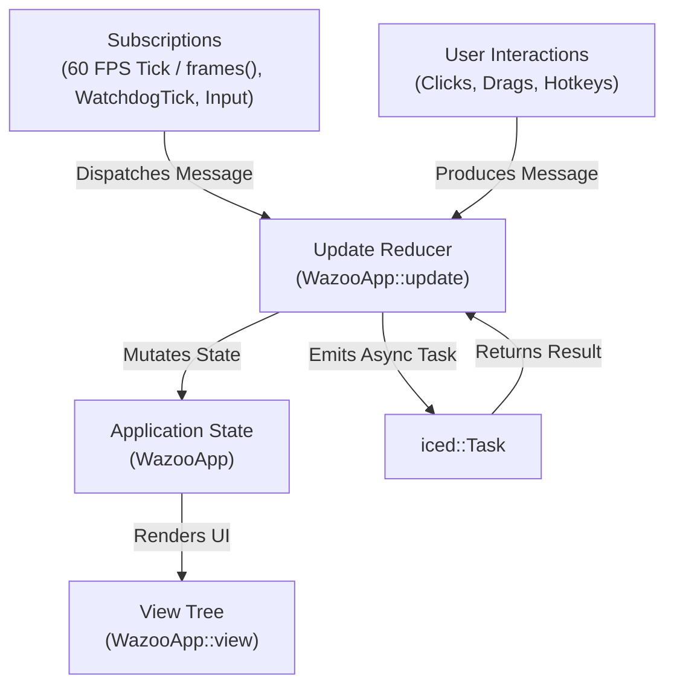
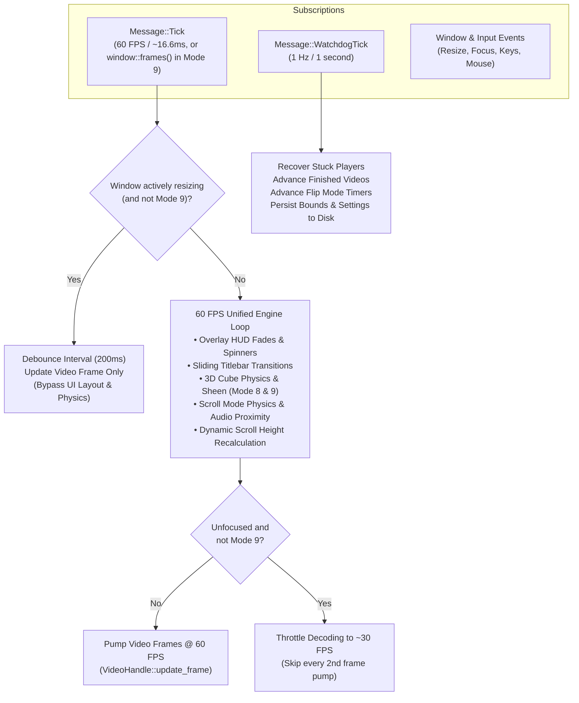

# `wazoo-app` Subsystem Architecture

The [`wazoo-app`] crate is the central desktop application. It integrates `wazoo-core`, `wazoo-media`, and `wazoo-scanner` using **The Elm Architecture (TEA)** pattern implemented with [Iced](https://github.com/iced-rs/iced).

---

## 📁 Module Organization

```
crates/wazoo-app/src/
├── app/            # WazooApp struct & domain submodules (boot, chrome, navigation, players, plex_explorer, quick_picker, search)
├── assets.rs       # Embedded font, SVG icon, and raw TV static frame loaders
├── cli.rs          # Command-line interface argument parser
├── color_picker.rs # Custom HSV color picker widgets (ColorSvPad, HueBar) & RGB/HSV helpers
├── cursor.rs       # Frameless window resize cursor hit-testing and edge detection
├── format.rs       # Display name sanitization, metadata title cleaning, and formatting utilities
├── keybinds.rs     # Key-to-message translation and custom shortcut binding
├── lib.rs          # Application entry point, window bootstrap, and run loop
├── main.rs         # Standalone binary entry point
├── message.rs      # Exhaustive enum of all UI and engine events (Message)
├── platform.rs     # OS-specific hooks (Linux PRIME check, cursor theme detection, console detaching)
├── scroll_view.rs  # Vertical feed layout container and shader quad integration
├── slide.rs        # Smooth animation curve and easing functions
├── state/          # Subsystem state encapsulations (players, cube, modals, plex, overlays, drawers, window, flip)
├── theme/          # ThemePalette resolution, WCAG light-theme contrast clamping, and widget styles
├── update/         # TEA state reducers partitioned by functional domain
├── views/          # Declarative Iced UI widgets, layouts, modals, settings tabs, and drawers
└── wrap.rs         # Dynamic horizontal wrapping layout widget for badges and tags
```

---

## 🏗️ The Elm Architecture (TEA) in Wazoo

Wazoo follows strict unidirectional data flow:



### Application Domain Submodules (`app/`)

Rather than keeping a monolithic `app.rs`, `WazooApp` and its supporting helpers are split across focused submodules in [`crates/wazoo-app/src/app/`]:

| Module | Responsibility |
| :--- | :--- |
| [**`mod.rs`**] | `WazooApp` struct definition, shared timing/layout constants, session history types, and Iced lifecycle hooks (`new`, `title`, `theme`, `subscription`). |
| [**`boot.rs`**] | CLI file ingestion, initial search resolution, library loading, initial `WazooApp` construction, async player startup, and scroll mode setup. |
| [**`chrome.rs`**] | Titlebar/dropdown slide & fade progress, floating HUD overlay opacity, cursor auto-hide logic, window opacity, and async transcript loading. |
| [**`navigation.rs`**] | Sequential/shuffle next & previous candidate selection, per-player back/forward navigation stacks, and global play history tracking. |
| [**`players.rs`**] | Focus lookups, off-thread `VideoHandle` initialization (`spawn_player_load_task`, `start_async_player_load`), pre-warmed standby handles, scroll preloading/cleanup, 3D cube spawning, and session saving. |
| [**`plex_explorer.rs`**] | Metadata lookups (`get_metadata_for_path`, `metadata_by_path`), Plex Explorer opening, live `OnDeck` / `RecentlyAdded` API fetches, and SQLite/text filtering. |
| [**`quick_picker.rs`**] | Quick Picker cache construction (`QuickPickerCache`) and asynchronous parent-directory sibling scanning via `tokio::task::spawn_blocking`. |
| [**`search.rs`**] | Folder filter chip selection, total library video counts, and toast notifications for search/scan result deltas. |

### State Decomposition (`WazooApp`)

To prevent a monolithic god object, application state in [`WazooApp`] is partitioned into focused child states under [`crates/wazoo-app/src/state/`]:

- **`players: PlayerList`**: Collection of [`AppPlayer`] handles, each wrapping a `VideoHandle` with per-tile shuffle mode, undo/redo history stacks, loading state (`is_loading`, `loading_alive`, `loading_ticks`), async replacement guards (`load_generation`, `load_retry_count`), independent `FlipState`, debounced seeking (`SeekDebounce`), per-player video aspect ratio memory (`last_aspect_ratio`), dedicated animated static frame buffer (`static_frame`), and cube-rendering flag (`is_cube`).
- **`window: WindowState`**: Tracks window ID, cursor position, focus status, modifier flags (`is_alt_pressed`, `is_shift_pressed`), drag state, resize debounce timestamps, mouse clickthrough mode, Picture-in-Picture corner state (`pip_corner: Option<PipCorner>`), cached `monitor_size`, `is_maximized`, and native borderless Fullscreen Mode (`is_fullscreen`).
- **`titlebar: TitlebarState`**: Controls sliding titlebar visibility, hover delays, hide timers, dropdown menu slide transitions, and double-click/drag gestures.
- **`overlay: OverlayState`**: Governs player HUD alpha fades, spinner rotation angles, TV static frame cadence, toast alerts, title pill badges, and focus border flash timers (`focus_border_ticks`).
- **`drawers: DrawerState`**: Holds visibility, debounce, and search states for the File Browser, Subtitle Transcript, and Play History side drawers.
- **`modals: ModalState`**: Manages modal dialog visibility (Search, Settings, Help, Bookmarks, Quick Picker, Plex Explorer, Menu), `QuickPickerCache`, active `SettingsTab` (`General`, `Playback`, `Filters`, `Crt`, `Cube`, `Plex`, `Theme`, `System`), and active HSV/hex color picker drafts (`active_color_picker`, `theme_picker_hsv`, `theme_hex_drafts`).
- **`plex: PlexState`**: Tracks Plex connection test state, sync progress/results, live `OnDeck`/`RecentlyAdded` results, and queried `explorer_items`.
- **`metadata_cache: HashMap<i64, MediaMetadata>`**: In-memory cache of synced Plex/media metadata keyed by `video_id`, loaded from SQLite on boot and refreshed after syncs.
- **`theme_palette: ThemePalette`**: Resolved color and geometry palette computed from `settings.theme` via `ThemePalette::from_settings`.
- **`cube: CubeState`**: Manages interactive 3D bouncing video cubes (`BouncingCube`), 3D Euler angles, velocities, bounce collision counters, speed/size multipliers, and transparent desktop screensaver overlay mode (Mode 9). Independent cube players (`new_cube`) bypass 2D UI loading buffers and aspect-ratio transformations to run purely on the cube rendering pipeline.
- **`raw_static_frames: Vec<RawStaticFrame>`**: Cached raw RGBA TV static noise frame buffers loaded from embedded GIF assets. Each active non-cube player dynamically center-crops from this library into its own `static_frame` to match the exact aspect ratio of the previously playing video without stretching or distortion.
- **`standby_player: Arc<Mutex<Option<VideoHandle>>>`**: Pre-warmed standby handle decoded off-thread on `"wazoo-prewarm-player"` so new players or 3D cubes attach without blocking the UI thread.
- **`settings: WazooSettings` & `scroll_engine: ScrollEngine`**: Active configuration loaded from `wazoo-core` and the vertical scroll layout/physics engine from `wazoo-media`.

---

## ⚡ The Modular Update Subsystem (`update/`)

Incoming [`Message`] events are dispatched through domain-specific reducers in [`crates/wazoo-app/src/update/`]:

| Module | Responsibility |
| :--- | :--- |
| [**`mod.rs`**] | Primary match dispatcher, `Message::Tick`, `Message::WatchdogTick`, and async `Message::PlayerHandleReady` handle attachment & retry handling. |
| [**`window.rs`**] | Window focus, resize, move, Alt-drag (`3x3` zone detection), dropdown menu, 4-stage pin/opacity/click-through cycling, PiP corner cycling (`Shift+P` / `CyclePipCorner` + `ApplyPipMonitorSize`), window aspect-ratio fitting (`FitWindow`), titlebar animations, and Fullscreen Mode (`F11`). |
| [**`playback/mod.rs`**] | Playback reducer dispatcher (`update_playback`), plus shared `focus_player_by_id` and `show_toast_for` helpers. |
| [**`playback/transport.rs`**] | Play/pause, seeking, frame-stepping, A-B loop marks (`MarkIn`/`MarkOut`), title overlay, subtitle toggle, and clipboard info copy (`CopyPlayerInfo`). |
| [**`playback/audio.rs`**] | Per-player volume, per-player and global mute, and audio track menu/selection. |
| [**`playback/layout.rs`**] | Multi-tile player count, layout cycling (`Grid`/`Row`/`Column`), focus cycling, shuffle mode, scroll mode, and flip mode transitions. |
| [**`playback/bookmarks.rs`**] | Bookmark creation/removal (`AddBookmarkFocused`, `RemoveBookmark*`) and `JumpToBookmark` navigation. |
| [**`navigation.rs`**] | Next/prev video, bi-directional navigation history stacks, and video auto-advancement. |
| [**`cube.rs`**] | 3D Video Cube screensaver (Mode 8), Desktop Overlay Mode (Mode 9), cube spawning/clearing, speed/size adjustments, and fullscreen coordination. |
| [**`drawers.rs`**] | File picker navigation, folder collapsing, transcript cues, and play history clearing. |
| [**`modals.rs`**] | Settings tab switching, post-processing filter toggles (`7` master toggle, CRT, Wavy, Fog), CRT shader parameter & preset tuning, live Theme color/preset/randomizer updates, equalizer sliders, Quick Picker, Help, and Bookmarks. |
| [**`plex.rs`**] | Plex integration enablement, server URL/token editing, connectivity testing, and streaming asynchronous library sync progress/completion. |
| [**`search.rs`**] | Search input changes, tag chip creation/removal, folder tag toggling, `search_include_metadata` toggle, and query execution. |
| [**`scanner.rs`**] | Native folder pickers (`rfd`), scan progress updates, cancellation, and library reloading. |
| [**`input.rs`**] | Hardware keyboard and mouse events mapped to configurable `KeyAction` commands (`F11` fullscreen, `Shift+P` PiP corner cycling, `7` master filters, `8` cube screensaver, `9` desktop overlay). |

---

## ⏱️ Engine Ticks, Async Loading & Subscriptions

Wazoo maintains a unified high-performance subscription and off-thread initialization architecture:



### Unified Engine Tick (`Message::Tick`)

1. **Always 60 FPS UI & Physics**: Overlay animations (spinner rotations, HUD alpha fades, toast countdowns), titlebar slide transitions, 3D cube velocity/collision physics, and vertical scroll kinematics run continuously (`~16.6ms` timer in standard mode, `iced::window::frames()` in Mode 9 desktop overlay).
2. **Selective Video Frame Throttling**: Rather than throttling the entire event loop, Wazoo selectively drops video frame pumping (`update_player_frames()`) to ~30 FPS (every 2nd tick) when the window is unfocused and not in Mode 9 desktop overlay, reducing GPU swapchain load and power usage while keeping hotkeys and UI animations responsive.
3. **Resize Debounce Guard**: When actively resizing the window (`WindowState::RESIZE_DEBOUNCE_DURATION = 200ms`), `subscription()` relaxes the tick interval and `Message::Tick` skips layout/physics updates while keeping video frames updating cleanly.
4. **Desktop Overlay Power Conservation**: When Desktop Overlay Mode (Mode 9) is active, background non-cube players are skipped by the watchdog and session persistence, refreshing only the active 3D cube player texture for smooth desktop screensaver performance.
5. **Scroll Engine Kinematics**: Computes real-time aspect ratio heights (`sync_scroll_item_heights`), despawns offscreen video tiles, pre-warms adjacent video tracks, and modulates audio volume based on viewport proximity.

### Non-Blocking Async Player Initialization

To prevent `libmpv` stream probing or slow storage/network I/O from freezing the UI thread:
- **Placeholder First**: Boot and player switching immediately attach a zero-blocking `VideoHandle::new_placeholder` with `is_loading = true` so the TV static animation and UI stay responsive at 60 FPS.
- **Off-Thread `spawn_blocking`**: `spawn_player_load_task` initializes the real `VideoHandle` on a Tokio blocking worker and delivers it via `Message::PlayerHandleReady { player_id, generation, result }`.
- **Stale Generation & Retry Guards**: Each player carries a monotonic `load_generation`; superseded handles arriving late are dropped on a background thread. Failed or timed-out loads increment `load_retry_count` (capped at `MAX_VIDEO_LOAD_RETRIES = 3`) before skipping to the next video.
- **Pre-Warmed Standby**: `replenish_standby_player` decodes the next candidate's initial presentation frame off-thread so adding a tile or spawning a cube attaches in microseconds.

---

## 🎨 View Layer, Theme & Components (`views/`, `theme/`)

Wazoo's user interface is fully custom, frameless, and themeable:

- **Stable Modal Layering (`views/mod.rs`)**:
  - When any modal is active, `view()` renders a fixed 2-child `Stack` (`[main_content, modal_el]`) without inserting or removing transient overlays (toast, titlebar, scan banner), preventing widget tree index shifts that would drop input focus.
- **Multi-Tile Playback Layouts (`views/player/`):**
  - **Grid**: Displays 1 to 12 players in an adaptive multi-column/row matrix.
  - **Row**: Aligns players horizontally in a continuous filmstrip.
  - **Column**: Stacks players vertically.
  - **Scroll**: Infinite vertical feed container rendered via [`scroll_view.rs`].
- **3D Video Cube Screensaver & Desktop Overlay Mode (`views/cube.rs`):**
  - Interactive spinning 3D cubes projecting live video onto all 6 faces with specular sheen highlights and bouncing collision physics.
  - **Mode 8 (In-App Screensaver)**: Renders floating 3D cubes over the playback canvas within the application window.
  - **Mode 9 (Desktop Overlay Mode)**: Borderless, mouse-passthrough transparent desktop overlay screensaver.
  - **Interactive Sheen & Focus Flashes**: Specular sheen lighting bands sweep across cube faces, and clicking a cube focuses its independent player with a brief focus border flash.
- **GPU Post-Processing Shader Filters (`views/modals/settings/filters_tab.rs`, `crt_tab.rs`):**
  - Centralized master filter toggle (`7` key) applying all enabled GPU filters simultaneously across video quads:
    - **CRT Scanline & Phosphor Glow**: Configurable via the dedicated `CRT` settings tab (`crt_tab.rs`) with presets (`Default`, `Subtle`, `Arcade`, `WarmPhosphor`, `Monochrome`, `Vhs`) and sliders for scanline darkness/density/speed, tube curvature, corner rounding, gamma, saturation, brightness, vignette, chromatic aberration, RF noise, and tracking glitch intensity/frequency.
    - **Wavy Fluid Displacement**: Procedural sinusoidal UV distortion creating liquid rippling effects.
    - **Volumetric Fog**: Multi-octave fractional Brownian motion (fBm) procedural noise generating ambient drifting smoke across the frame.
    - **Aspect-Ratio Border Protection**: Clamping against normalized content boundaries (`target_aspect`) prevents edge-smear artifacts on non-16:9 content.
- **Shader-Processed TV Static Loading State (`views/player/card.rs`):**
  - Renders animated static RGBA noise frames through the WGPU `VideoProgram` shader pipeline (`0x8000_0000 | player_id`), so active CRT, wavy, and fog shaders apply seamlessly to loading tiles.
  - **Dynamic Center-Cropping & Per-Player Isolation**: Crops the raw static texture to each player's `last_aspect_ratio` without distortion, using independent per-player `static_frame` buffers and tracking `p.aspect_ratio()` to prevent layout jumps during transitions.
- **Custom Theme System & HSV Color Pickers (`theme/`, `color_picker.rs`, `views/modals/settings/theme_tab.rs`):**
  - `ThemePalette::from_settings` derives card, button, border, titlebar, badge, and HUD colors from user hex settings, and applies WCAG AA contrast clamping (`>= 4.5:1`) for muted text on light themes (`compute_muted_text` in `theme/colors.rs`).
  - The `Theme` settings tab offers a live mini preview (titlebar, focus ring, HUD pill), 7 presets (`Default`, `Amber`, `Mocha`, `FrostLight`, `Monokai`, `Turtle`, `Strawberry`), one-click theme randomization (`RandomizeTheme`), custom 2D `ColorSvPad` + 1D `HueBar` widgets (`color_picker.rs`), hex inputs, quick swatches, and sliders for HUD opacity, corner radius, and focus ring width.
- **Quick Picker (`views/modals/quick_picker_modal.rs`, `app/quick_picker.rs`):**
  - Opens a fast modal listing sibling videos from the focused player's library folder or parent filesystem directory.
  - Precomputes `QuickPickerCache` (`QuickPickerEntry` with pre-lowercased titles and metadata badges) on modal open, moves filesystem sibling scanning off the UI thread (`Message::QuickPickerDiskSiblingsLoaded`), and caps displayed rows at 200 (`MAX_QUICK_PICKER_DISPLAY`) to eliminate UI freezes on large folders.
- **Plex Semantic Media Explorer (`views/modals/plex_modal.rs`, `app/plex_explorer.rs`):**
  - Queries SQLite directly (`db.query_plex_explorer(...)`, up to 250 items) rather than scanning an in-memory copy of the entire library, while `On Deck` and `Recently Added` tabs also support live `PlexClient` API fetches.
  - Displays an unconfigured-auth or disabled warning banner with one-click navigation to the `Plex` settings tab when Plex is not yet configured.
  - Supports persistent genre & decade (`pre-30s`–`20s`) filters, live multi-field search, `Surprise Me` seeded random sampling (truncated to 150 items), resume offset badges, and one-click playback.
- **Windowing Modes (`update/window.rs`):**
  - **Picture-in-Picture (`Shift+P` / `CyclePipCorner`)**: Enables Always-on-Top, exits fullscreen/maximized if active, computes aspect-ratio-matched PiP dimensions on initial activation, and cycles clockwise across screen corners (`BottomLeft` → `TopLeft` → `TopRight` → `BottomRight`).
  - **Fullscreen (`F11`) & Fit-to-Video (`FitWindow`)**: Native borderless fullscreen toggling and window aspect-ratio fitting accounting for open side drawers.
  - **4-Stage Pin / Opacity / Click-Through Cycle (`CyclePinMode`)**: Cycles normal → pinned 100% → pinned 40% click-through → pinned 15% click-through.
- **Frameless Titlebar, Drawers & Modals:**
  - **Titlebar (`views/titlebar.rs`)**: Slides down on hover or drag; auto-retracts when idle, with window controls, title, and dropdown navigation menu.
  - **Drawers**: **File Picker** (`views/file_picker.rs`), **Transcript** (`views/transcript.rs`), and **Play History** (`views/history.rs`).
  - **Modals**: **Search** (`views/modals/search_modal.rs`, with tag chips, multi-folder chips, and `Filename` / `Metadata` search toggle), **Bookmarks** (`bookmarks_modal.rs`), **Help** (`help_modal.rs`), **Context Menu** (`menu_modal.rs`), and 8-tab **Settings** (`General`, `Playback`, `Filters`, `Crt`, `Cube`, `Plex`, `Theme`, `System`).
- **HUD Overlays (`views/player/hud.rs`):**
  - Transport controls, A-B loop badges, one-click clipboard info copy (`CopyPlayerInfo` / `format_player_copy_info` for title, file path, and Plex metadata), toast notifications, and clickable title pills displaying cleaned Plex metadata (`format::clean_metadata_title`, `SxxExx`, year, content rating, genres, star rating) when synced metadata is present.

---

## 🖥️ Platform Integration (`platform.rs`)

Provides operating system integration hooks:

1. **POSIX-Safe Process Detaching**: Spawns a detached child process with `--foreground` and standard I/O bound to `Stdio::null()` in a new process group, avoiding thread/allocator deadlocks associated with raw `libc::fork()` under custom global allocators (`mimalloc`).
2. **Hardened Web Navigation**: `open_url` strictly validates URL schemes (`http://`, `https://`) and invokes `rundll32 url.dll,FileProtocolHandler` on Windows to avoid shell interpretation and command separator injection (`&`, `|`, `^`, `%`).
3. **Desktop Entry & Cursor Integration**: Dynamically creates `.desktop` integration entries on Linux following the XDG Desktop Entry Specification, and detects Linux desktop cursor themes/sizes across GNOME/Cinnamon/MATE/XFCE/KDE.
4. **Hybrid GPU Detection**: Detects dual-GPU hybrid laptops on Linux to default to the integrated GPU, preventing cross-GPU DRI3 PRIME swapchain presentation failures.
